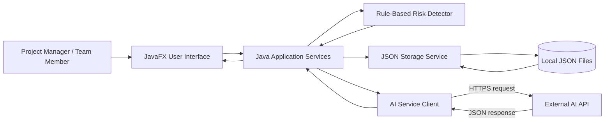

# System Diagram

## Component Responsibilities

- **JavaFX User Interface:** Collects input and displays projects, tasks, risks, and recommendations.
- **Java Application Services:** Applies project rules and coordinates storage, risk detection, and AI requests.
- **Rule-Based Risk Detector:** Identifies factual issues such as overdue, blocked, or unassigned tasks.
- **JSON Storage Service:** Saves and loads local project data with Jackson.
- **AI Service Client:** Sends selected project facts to the external API and validates its response.
- **External AI API:** Produces summaries, explanations, and suggested next actions.

The AI cannot directly edit project data. A user must approve a recommendation through the interface before the application applies it.
